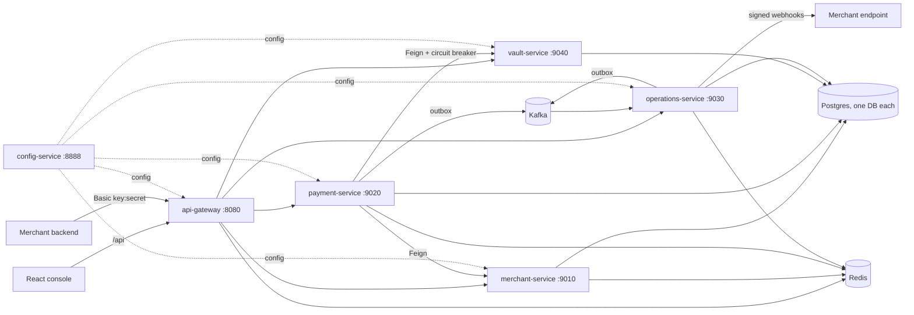

# PayFlow: Distributed Payment Gateway

A Razorpay-style payments platform built as Spring Boot microservices, with a React merchant console.
Merchants sign up, complete KYC, create orders, take card / UPI / netbanking payments against a simulated
bank, refund them, receive signed webhooks and get settled, with the reliability patterns a real gateway needs:
transactional outbox, idempotency, circuit breakers, a payment state machine and envelope-encrypted card storage.



| Module | Role | Port |
|---|---|---|
| `api-gateway-service` | Edge: API-key / JWT authentication, per-key rate limiting, routing | 8080 |
| `merchant-service` | Signup/login, profile, KYC, settlement account, API keys, webhook configs, customers | 9010 |
| `payment-service` | Orders, payments, state machine, refunds, transactional outbox, bank simulator | 9020 |
| `operations-service` | Webhook delivery with retries + DLQ, settlements, delivery log | 9030 |
| `vault-service` | Card tokenization (envelope encryption) and charging | 9040 |
| `config-service` | Spring Cloud Config server (serves `config-repo/`) | 8888 |
| `discovery-service` | Eureka (optional; Feign uses direct URLs) | 8761 |
| `common-lib` | Shared auto-configuration: idempotency, rate limiters, errors, audit, paging | n/a |
| `frontend` | React + Vite + Tailwind merchant console | 5173 |
| `config-repo` | Configuration served by `config-service` | n/a |
| `k8s`, `observability` | kind/Kustomize manifests; Zipkin, Prometheus, Grafana | n/a |

Java 25, Spring Boot 4.1, Spring Cloud 2025.1. Postgres 16, Redis 7, Kafka.

## What it does

| Area | Capabilities |
|---|---|
| **Onboarding** | Signup/login (JWT), business profile, settlement bank account (masked), sandbox KYC that activates the account |
| **API access** | API keys (test/live), secret shown once, rotation with a 24 h grace period, revocation, Basic auth at the gateway |
| **Payments** | Orders; card, UPI and netbanking; asynchronous bank response; auto-capture; full lifecycle timeline per payment |
| **Refunds** | Partial and full, multiple partials, balance enforced, payment state follows (`PARTIALLY_REFUNDED` / `REFUNDED`) |
| **Settlements** | 2% fee + 18% GST on the fee, refunds netted out, nightly job plus run-now, bank-transfer callback, payments marked settled |
| **Webhooks** | HMAC-SHA256 signed, exact signed bytes are the body, backoff retries (7 attempts), dead-letter queue, delivery log and replay |
| **Reliability** | Idempotency keys on every write, transactional outbox, ShedLock for singleton jobs, circuit breaker + retry between services, bulkhead around card processing |
| **Security** | Card numbers encrypted per card with a wrapped data key, CVV never stored, tokens bound to the merchant that created them, `/internal/**` not routed by the gateway |
| **Console** | Overview, payments (filters, detail, refund), orders, settlements, API keys, webhook endpoints and deliveries, account and KYC |

## Run it locally

1. Start Postgres (databases `razorpay-{merchant,payment,operations,vault}-db` with users
   `{merchant,payment,operations,vault}_user`), Redis and Kafka on their default ports.
2. Export the secrets each service needs (see `config-repo/README.md`): `JWT_SECRET`,
   `WEBHOOK_SECRET_ENCRYPTION_KEY` and `VAULT_MASTER_KEY` (both base64, 32 bytes) and the four `*_DB_PASSWORD`
   values. Give each service only its own secrets.
3. Build the shared library: `cd common-lib && ./mvnw install`.
4. Start `config-service`, then the business services, then `api-gateway-service`
   (`./mvnw spring-boot:run` in each directory).
5. `cd frontend && npm install && npm run dev` and open http://localhost:5173.

`config-service` reads this repository's `config-repo/` folder by default. Override with `GIT_CONFIG_REPO`,
`GIT_CONFIG_PATH`, `GIT_CONFIG_LABEL`, `GIT_USERNAME`, `GIT_PASSWORD`.

> **Local `file://` config repos:** Spring Cloud Config uses a local directory as its own working copy and
> hard-resets it to `origin/main`. Point it at a throwaway clone, never at the repository you are working in.

### First steps in the console

1. **Sign up**, then open **Account**: add a settlement account and complete KYC (any well-formed PAN works).
2. **Webhooks**: add `http://localhost:9030/webhook/success` (the built-in dummy receiver).
3. **Payments > New test payment**: use the test card shortcuts, then watch the payment move to *Captured*.
4. Open the payment to see its timeline and issue a refund; run a settlement from **Settlements**.

### Test data

| Input | Result |
|---|---|
| Card `4111 1111 1111 1111` | Succeeds |
| Card `4000 0000 0000 0002` | `CARD_DECLINED` |
| Card `4000 0000 0000 0069` | `CARD_EXPIRED` |
| UPI `fail@okaxis` | `UPI_REJECTED` |
| Netbanking bank `BANK_CODE_FAIL` | `BANK_REJECTED` |

## Tests

```bash
# unit tests (state machine, refund rules, settlement math, idempotency filter, rate limiter, KYC rules)
for m in common-lib payment-service operations-service merchant-service; do (cd $m && ./mvnw test); done

# end-to-end smoke test against a running stack (48 checks)
node scripts/smoke-test.mjs
```

## API overview

All routes go through the gateway and need either `Authorization: Bearer <jwt>` or `Authorization: Basic
<keyId:secret>`. Writes accept an `X-Idempotency-Key` header. Lists are paged (`page`, `size`) and return
`{ items, page, size, totalItems, totalPages }`. Amounts are in paise.

| Method | Path | Purpose |
|---|---|---|
| POST | `/v1/auth/signup`, `/v1/auth/login` | Account creation, JWT |
| GET, PUT | `/v1/merchants/me` | Profile |
| PUT | `/v1/merchants/me/settlement-account` | Payout bank account |
| POST | `/v1/merchants/me/kyc` | Sandbox KYC, activates the account |
| GET, POST | `/v1/merchants/api-keys` | List / create keys |
| POST, DELETE | `/v1/merchants/api-keys/{id}/rotate`, `/v1/merchants/api-keys/{id}` | Rotate / revoke |
| GET, POST, PUT, DELETE | `/v1/merchants/webhooks[/{id}]` | Webhook endpoints |
| POST | `/v1/vault/tokenize` | Tokenize a card |
| POST, GET | `/v1/orders`, `/v1/orders?status=` | Create / list orders |
| GET, POST | `/v1/orders/{id}`, `/v1/orders/{id}/cancel`, `/v1/orders/{id}/payments` | Order detail, cancel, attempts |
| POST, GET | `/v1/payments`, `/v1/payments?status=&method=&orderId=` | Initiate / list payments |
| GET | `/v1/payments/{id}`, `/v1/payments/{id}/timeline` | Detail, state history |
| POST | `/v1/payments/{id}/capture` | Manual capture of an authorized payment |
| POST, GET | `/v1/payments/{id}/refunds` | Create / list refunds (omit `amountUnits` to refund the balance) |
| GET | `/v1/refunds` | All refunds |
| GET, POST | `/v1/settlements`, `/v1/settlements/{id}`, `/v1/settlements/run` | Payouts, run now |
| GET, POST | `/v1/webhook-events[/{id}]`, `/v1/webhook-events/{id}/replay` | Delivery log, replay |

Webhook payloads are signed: `X-Razorpay-Signature` is `HMAC-SHA256(body, webhookSecret)`, computed over the exact
request body. Events: `ORDER_CREATED`, `ORDER_CANCELLED`, `PAYMENT_CREATED`, `PAYMENT_STATUS_CHANGED`,
`PAYMENT_AUTHORIZATION_COMPENSATED`, `REFUND_CREATED`, `SETTLEMENT_PROCESSED`, `SETTLEMENT_FAILED`.

## Design notes

- **Payment state machine.** Every transition is validated and written to an audit log with its actor, which is
  what the timeline in the console shows.
- **Transactional outbox.** Events are written in the same transaction as the state change and relayed to Kafka
  by a ShedLock-guarded poller, so a crash can never publish an event for a rolled-back change or lose one.
- **Idempotency.** A Redis-backed filter replays the stored response for a repeated key, rejects concurrent
  duplicates and does not cache errors, so clients can retry safely.
- **Webhook integrity.** The exact bytes that were signed are persisted and sent. Re-serializing a JSON map
  (or reading it back from `jsonb`) can reorder keys and break the signature.
- **Card vault.** Each card gets its own random data key; the PAN is encrypted with it and the key is wrapped by a
  master key. Tokens are only chargeable by the merchant that created them.
- **Fault isolation.** One merchant failing to settle never aborts the batch, and a remote error message can
  never overflow a database column.

## Kubernetes

`k8s/` targets a kind cluster. Copy `k8s/k8s-secrets.env.example` to `k8s/k8s-secrets.env`, fill in real
values, then `kubectl apply -k k8s`. Never commit `k8s-secrets.env`.

## Known limitations

- The bank, KYC and bank-transfer providers are simulators; no real money moves.
- Schemas are managed by Hibernate `ddl-auto: update`. A production setup would use Flyway or Liquibase.
- Downstream services trust the gateway's `X-Merchant-Id` header and have no Spring Security of their own;
  `/internal/**` relies on the gateway not routing it plus network policy.
- Wallet payments are modelled but have no processor.
